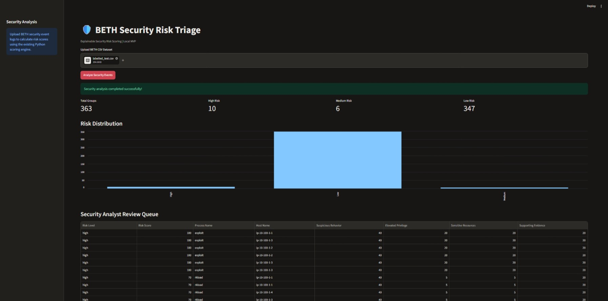
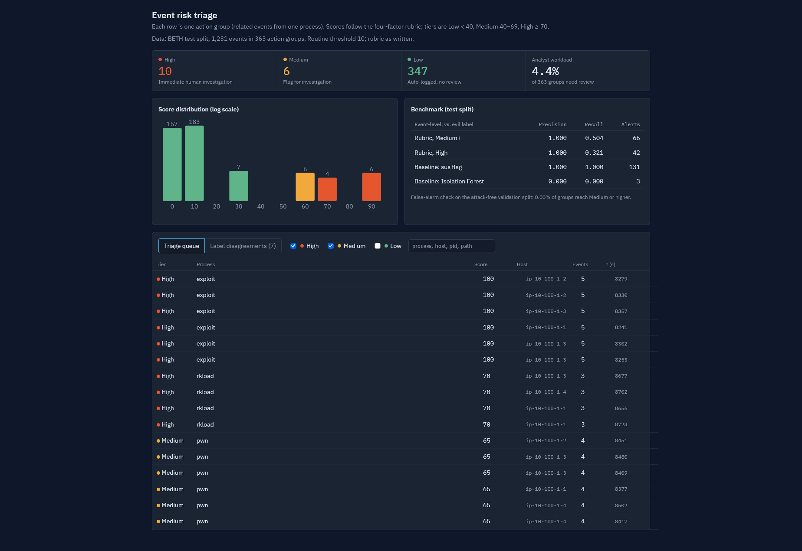

# BETH Risk Triage — Streamlit MVP

This folder contains my contribution to the AIT 670
BETH Risk Triage group project.

## Features
- Interactive Streamlit dashboard
- BETH CSV dataset upload
- Explainable security risk scoring
- High, Medium, and Low risk classification
- Security analyst review queue
- Risk distribution visualization
- CSV results export

## Testing
All 17 automated tests passed during local testing.

## Screenshots

### Interactive Streamlit Dashboard

### Original Security Risk Triage Dashboard

